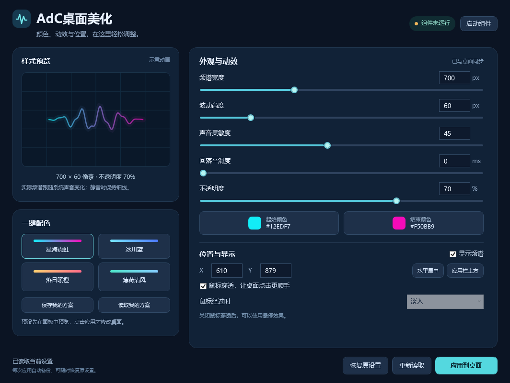

# ADC 总控台

在一个窗口中管理音乐频谱和 Nexus 启动栏。频谱页面提供模拟音源预览；Nexus 页面提供启动、原生详细设置入口和悬停文字开关。仍支持选装透明任务栏和动态壁纸。

> 1.2.5 测试版：已在 Windows 11 实际构建、安装并运行控制台，自动测试包含 313 项 WPF 交互与布局检查。预览仍使用模拟音源；Nexus 悬停效果、设置窗口响应和重启登录尚未完整验收，详见[测试报告](docs/TEST-REPORT.md)。

原 1.0 频谱界面参考（不代表新的总控台布局）：



## 包含什么

- **ADC 总控台**：WPF / .NET Framework 4.8，提供配色预设、颜色选择、滑块、定位按钮、个人方案和恢复原设置。
- **可重复的安装流程**：固定版本下载、SHA-256 校验、自选安装位置、桌面快捷方式、启动和恢复入口。
- **默认安装**：Rainmeter、时钟/频谱皮肤、控制台和 Nexus；`-IncludeNexus:$false` 可只装频谱。完整模式再加 TranslucentTB 和动态壁纸。
- **开发与发布材料**：源码、构建脚本、隔离测试、GitHub Actions、第三方依赖清单。

本仓库提供原创代码和安装编排。第三方软件、皮肤、字体、壁纸以及机器上的个人设置都不随源码分发。

## 快速开始

适用于 Windows 11 x64，需 Windows PowerShell 5.1 和 .NET Framework 4.8。Windows 11 通常已包含这两项；构建控制台不需要安装 .NET SDK。

下载并解压仓库后，打开 PowerShell，进入项目目录运行：

```powershell
# 默认：Rainmeter、所需皮肤、频谱控制台和 Nexus 启动栏
.\Install.ps1 -InstallDir 'D:\AdCDesktop'

# 只装频谱/控制台，不装 Nexus
.\Install.ps1 -InstallDir 'D:\AdCDesktop' -IncludeNexus:$false
```

也可直接双击 `Install.cmd`。没有 D 盘时，不指定目录会使用当前用户的本地应用数据目录。双击入口会按 **Full 完整桌面** 安装：隐藏桌面图标、自动隐藏任务栏，并加入 Nexus；安装结束后自动启动 Rainmeter、频谱和 Nexus。Nexus 官方安装器可能弹出 Windows 管理员授权，需要点“是”。不会添加开机自启。

完成后，Nexus 和频谱会自动打开；也可以双击桌面的 **ADC 总控台** 继续调整配色、滑块，再点击 **应用到桌面**。

### 一键安装（无需解压）

从 Releases 下载 `ADC-Desktop-Setup-1.2.5.exe`，直接双击。程序会在临时目录内展开安装文件，自动下载/校验 Rainmeter、皮肤和 Nexus，构建控制台，创建快捷方式，应用完整桌面效果并启动。首次 Nexus 安装请在 Windows 管理员提示中点“是”。

安装后桌面提供：

- **启动AdC桌面美化**：重新启动 Nexus 和频谱，并保持完整桌面效果
- **恢复原桌面**：恢复安装前的图标、任务栏和壁纸设置

如果浏览器或 Windows 对未签名 EXE 弹出 SmartScreen，点“更多信息 → 仍要运行”。也可以下载 `ADC-Desktop-Setup-1.2.5.zip` 作为备用，解压后双击 `Install.cmd`。

## 新手教程

打开程序后点击“上手教程”，或直接打开随包的 `QuickStart.html`。教程包含首次打开、独立自启动开关、频谱调节、关闭 Nexus 大字和恢复设置。源码中的教程见 [QuickStart.html](docs/QuickStart.html)。

## 两个开机自启动开关

窗口顶部独立控制频谱（Rainmeter）与 Nexus，点击即保存，下次登录 Windows 后生效。默认读取现有状态，不会因打开总控台就自动开启。关闭开关不退出正在运行的程序。

这两个开关只管理 ADC 创建的当前用户启动项。若原生程序另设自启动，页面会提示已识别的原生启动项；可通过“系统启动项”或原程序设置关闭。Windows 禁用的启动项不会被强制重新启用。移动目录前应先关闭开关。

## 总控台的两个页面

- **音乐频谱**：颜色、宽高、透明度、灵敏度与回落平滑度即时模拟预览；支持暂停和模拟静音。预览不采集系统音频，不等同于 Rainmeter 的实际 FFT；点击“应用到桌面”才改变频谱设置。
- **Nexus 启动栏**：检测安装路径、启动程序、打开详细设置；对已识别的配置关闭图标标签和延迟气泡，或恢复原文字设置。未识别的配置禁用写入并提供手动路径。

关闭视频中的悬停文字：进入 Nexus 页面 → 先从 Nexus 右键菜单退出程序 → 点击“关闭所有悬停文字” → 点击“启动 Nexus”。只修改文字开关，保留图标排列、主题和应用路径。首次修改会备份原值。详见 [Nexus 设置说明](docs/NEXUS.md)。

已有安装可以关闭控制台后运行更新安装器，它会先备份程序、校验安装文件并保留已有配置：

```powershell
.\scripts\Build-ControlPanel.ps1
.\scripts\Install-ControlCenter.ps1 -InstallDir 'D:\AdCDesktop' -Launch
```

开发者可运行 `.\scripts\Build-Package.ps1` 生成 `artifacts/packages/ADC-ControlCenter-1.2.5.0.zip` 和 SHA-256 校验文件。解压更新包后双击其中的 `Install.cmd`，选择已有安装根目录即可。无需重装 Rainmeter 或 Nexus；包内不含第三方程序或皮肤。

## 完整桌面组合

```powershell
.\Install.ps1 -Mode Full -InstallDir 'D:\AdCDesktop' `
  -IncludeNexus -IncludeTaskbar
```

也可双击 `Install-Full.cmd` 安装完整组合；壁纸仍需先在自己的 Steam 账户中准备好。

| 组件 | 用途 | 获取方式 |
|---|---|---|
| Rainmeter | 时钟和音乐频谱 | 安装时下载官方便携组件及皮肤 |
| Nexus | 底部应用启动栏 | 可选；官方安装器可能显示 Windows 管理员确认 |
| TranslucentTB | 透明任务栏 | 可选；官方 Windows 11 便携包 |
| Wallpaper Engine | 动态壁纸 | 用户自行购买、安装和订阅壁纸 |

Nexus 免费版仅限个人使用；商业、企业用途请先确认相应许可。每个组件继续适用自己的条款，见 [第三方说明](THIRD_PARTY_NOTICES.md)。

Nexus 安装后需按 [启动栏布局指南](docs/NEXUS.md) 设置底部居中、透明背景和自己的常用应用。已有 Nexus 配置会受到保护，安装器不会导入作者的个人启动栏。

### 使用同款星海壁纸

1. 在 Steam 安装自己拥有的 Wallpaper Engine。
2. 订阅 [Dome 4k {Artwork by WLOP}](https://steamcommunity.com/sharedfiles/filedetails/?id=3113287126)。
3. 下载完成后，在 Wallpaper Engine 里对该壁纸选择“在资源管理器中打开”，取得 `project.json` 路径。
4. 安装时传入实际路径，例如：

```powershell
.\Install.ps1 -Mode Full -InstallDir 'D:\AdCDesktop' `
  -IncludeNexus -IncludeTaskbar `
  -WallpaperEnginePath 'D:\SteamLibrary\steamapps\common\wallpaper_engine' `
  -WallpaperProject 'D:\SteamLibrary\steamapps\workshop\content\431960\3113287126\project.json'
```

壁纸文件仅从用户已订阅的本地内容读取，不从本仓库下载或再分发。安装脚本会对已识别的同款 Dome 私有副本关闭内置时钟、媒体和频谱，以配合 Rainmeter 组件。

### 启动与恢复

安装目录提供 `Start-Desktop.cmd` 和 `Restore-Desktop.cmd`，也会按安装选项创建桌面入口。

- 启动：根据本机清单启动已选组件，按需应用壁纸和桌面布局。
- 恢复：恢复本次启用前的图标、任务栏和壁纸外观，停止本安装目录内的组件。
- 控制台中的 **恢复原设置** 只恢复频谱，适合撤销自己在面板里的调整。

若启动前已有 Wallpaper Engine 壁纸，恢复时会重新打开已备份的项目；原先未运行动态壁纸时，通过 `closeWallpaper` 撤下本次效果并恢复静态壁纸。后台程序保持正常运行。无法可靠备份正在使用的壁纸时，启动脚本会保留该壁纸并继续启动其他组件。

## 先查看计划或离线部署

```powershell
# 查看计划，不下载、不安装、不修改桌面
.\Install.ps1 -InstallDir 'D:\AdCDesktop' -WhatIf

# 使用已准备好的组件，禁止网络下载及运行第三方安装器
.\Install.ps1 -InstallDir 'D:\AdCDesktop' -Offline `
  -PreparedComponentsPath 'E:\PreparedAdCDesktop'
```

离线组件布局和完整参数见 [安装说明](docs/INSTALLATION.md)。下载地址、版本、校验值和来源见 [依赖说明](docs/DEPENDENCIES.md)。下载不可用时，脚本会报告失败，不会跳过校验继续运行未知文件。

## 开发与测试

```powershell
.\scripts\Build-ControlPanel.ps1
.\tests\Test-ControlPanel.ps1
.\tests\Test-SkinData.ps1
.\tests\Test-Scripts.ps1
.\tests\Test-Install.ps1
.\tests\Test-StartupPreflight.ps1
.\tests\Test-PublishGate.ps1
.\scripts\Test-Publish.ps1
```

编译输出为 `artifacts/control-panel/AdCDesktop.exe`。也可以用 Visual Studio 打开 `src/ControlPanel/AdCDesktop.csproj`。测试使用独立样本目录，不修改真实桌面；具体说明见 [开发指南](docs/DEVELOPMENT.md)。

## 上传到 GitHub

本项目已按源码仓库整理。上传源码和文档即可，**不要把本机安装目录或下载缓存整体上传**。

可以使用 GitHub Desktop 的“添加现有仓库 → 提交 → Publish repository”，也可以按 [发布指南](docs/PUBLISHING.md) 使用 Git。

GitHub Actions 会在 Windows 上运行构建与隔离测试，并提供仅包含原创控制台的构建产物。未授权再分发的皮肤、第三方程序和壁纸不进入产物。

## 许可

原创代码、图标和控制台界面采用 [MIT License](LICENSE)。此许可不覆盖安装时获取的第三方软件、皮肤、字体、音乐或壁纸；其来源和限制列于 [THIRD_PARTY_NOTICES.md](THIRD_PARTY_NOTICES.md)。
